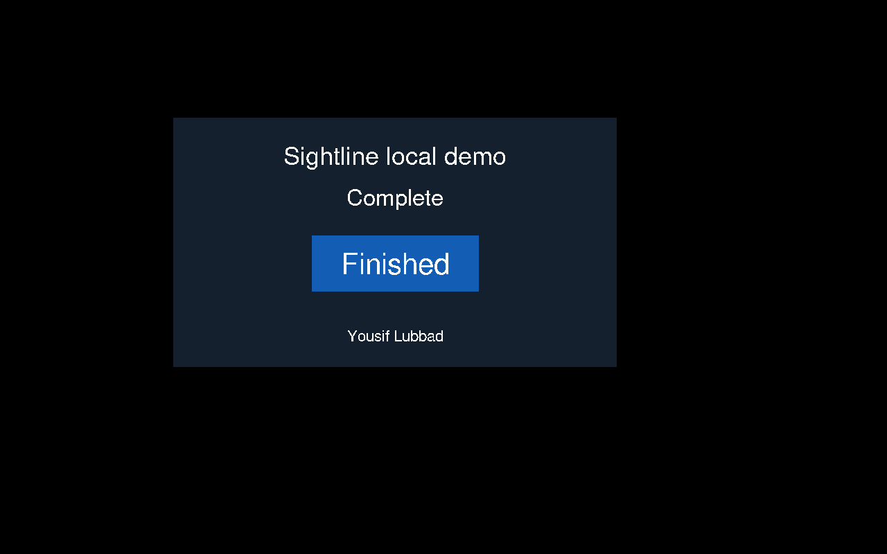

# Sightline

**A vision-only interface automation engine by Yousif Lubbad.**

Sightline reads screen pixels, finds visible text, and clicks its center. Its
long-term goal is to operate unfamiliar interfaces without DOM selectors,
accessibility trees, or app-specific APIs. Phase 1 delivers the first working
slice: **capture → OCR → find a unique label → click**.

**Status:** Phase 1 foundation, `0.1.0.dev1`. The package builds locally. The
`sightline-ui` name is used in metadata; it is not reserved or published to PyPI.
Later features are tracked in [the roadmap](docs/roadmap.md).

## Working today

| Area | Phase 1 implementation |
| --- | --- |
| Frames | Immutable RGB images, validated boxes, image-to-desktop coordinate scaling |
| Sources | A `FrameSource` interface, saved images, primary-screen MSS capture |
| OCR | Lazy EasyOCR loading, CPU inference, explicit model downloads, validated detections |
| Locators | Exact or substring matching, Unicode normalization, confidence filtering, duplicate rejection |
| Input | A proposed click by default; explicit execution with bounds, age, display-size, and fail-safe checks |
| Engineering | pytest, Ruff, strict mypy, typed package, source/wheel builds, GitHub Actions configuration |

The engine never receives widget IDs or the demo's state. The end-to-end test
uses the app's state only as an independent check that the mouse click worked.



## Run the local demo

These instructions are for the owner and separately authorized developers;
reuse is governed by [LICENSE](LICENSE). Use an app you own on a controlled
desktop. Keep the demo visible on the primary screen.

Python 3.11+ is required. The actual model and desktop tests were run on Python
3.12/Linux X11. See [setup and troubleshooting](docs/setup.md) for system packages,
Windows activation, display permissions, and headless testing.

```bash
python3.12 -m venv .venv
source .venv/bin/activate
python -m pip install --upgrade pip
python -m pip install --index-url https://download.pytorch.org/whl/cpu torch==2.15.0+cpu torchvision==0.29.2+cpu
python -m pip install -e '.[dev,desktop,ocr]'
python -m examples.demo_app
```

In a second terminal, from the same checkout and activated environment:

```bash
# Download missing English weights and print a proposed click. No mouse event is sent.
python -m examples.find_and_click Start --download-models

# Click the static demo once. Its visible status should change to Complete.
python -m examples.find_and_click Start --click --max-frame-age 30
```

Full-screen CPU OCR exceeded the normal five-second frame-age limit in the test
environment. The static demo opts into 30 seconds; do not increase that limit
for a changing interface. A scene can still change between capture and input.
The core does not yet wait for stability or verify actions. Keep PyAutoGUI's
corner fail-safe on, and use Ctrl+C to stop a running example.

For an image you own, no desktop is required:

```bash
python -m examples.find_and_click Start --image path/to/screen.png --download-models
```

Output is JSON with the recognized label, confidence, pixel box, proposed desktop
point, and whether a click was executed. Saved images have no mouse mapping and
cannot be clicked. Missing text, duplicate matches, and backend failures produce
a clear error and a nonzero exit status. See [the API guide](docs/architecture.md).

## Verification

```bash
python -m pip install -e '.[dev]'
ruff format --check .
ruff check .
mypy
pytest --cov --cov-report=term-missing
python -m build
python scripts/verify_dist.py
```

The normal suite does not open a desktop, download models, or send mouse events.
Actual OCR and native tests require explicit flags and an isolated display:

```bash
OMP_NUM_THREADS=2 MKL_NUM_THREADS=2 xvfb-run -a -s '-screen 0 1280x800x24 -nolisten tcp' \
  python -m pytest --run-ocr --run-live --download-models -m 'ocr or live'
```

Recorded local results: **77 offline tests passed, 93% combined statement/branch
coverage**, and **five real OCR/native tests passed at each of 1280×800 and
1920×1080**, including light and dark themes. These are small correctness checks,
not a general benchmark. GitHub Actions runs the offline checks on Python 3.11–3.13
and the real model/native tests at both resolutions. See the
[latest CI results](https://github.com/YOUSIF-LUBBAD/Sightline/actions/workflows/ci.yml).
[Validation details and the 18 commits](docs/phase1.md).

## Current limits

Primary-screen clicking only. Linux X11 is the tested live backend; macOS,
Windows, Wayland, mixed-DPI monitors, and remote desktops need separate validation.
The scaling math has unit tests, but a real HiDPI device has not been tested.
English OCR is validated; Arabic layout reasoning belongs to the later roadmap.
Small, stylized, partly covered, or low-contrast text may not match reliably.
OCR confidence is a filter, not a correctness guarantee.

This version does not identify button semantics, avoid destructive labels by
meaning, explore apps, type text, self-heal, record/replay, or index video. It sends
one explicit click to a unique visible text match. There are no published speed,
precision, recall, or character-error claims yet.

## Ownership

Copyright (c) 2026 **Yousif Lubbad**. All rights reserved in his original
copyrightable contributions, subject to [LICENSE](LICENSE). Attribution is not
permission to reuse. Dependency and model rights stay with their respective
owners; see [THIRD_PARTY_NOTICES.md](THIRD_PARTY_NOTICES.md).

Outside contributions need an advance agreement under
[CONTRIBUTING.md](CONTRIBUTING.md). The source, demo app, and generated
test fixtures are original to Sightline. License notices state rights and
restrictions; they cannot physically prevent copying or guarantee a legal outcome.
